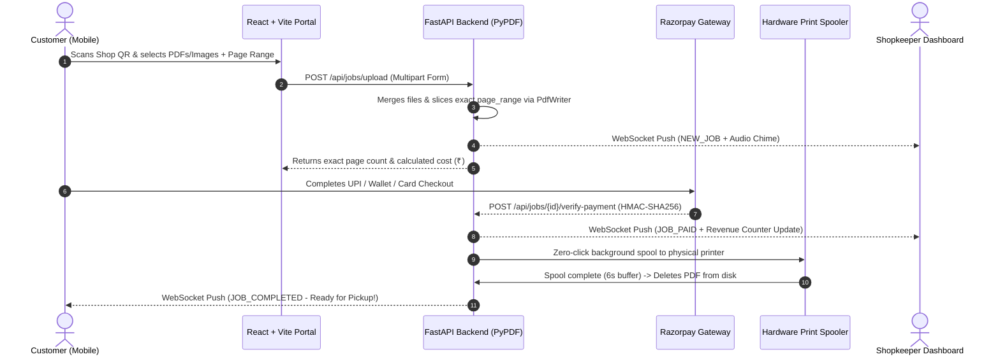

## System Architecture & Zero-Click Print Flow

---

## Core REST & WebSocket API Reference

| Method | Endpoint | Description |
| :--- | :--- | :--- |
| `POST` | `/api/shops/` | Registers a new print shop, pricing card, and generates its unique QR code |
| `GET` | `/api/shops/{shop_id}` | Fetches shop metadata and live per-page rate card (`B&W` / `Color`, `Single` / `Double`) |
| `POST` | `/api/shops/{shop_id}/login` | Authenticates shopkeeper PIN and returns a signed `HMAC-SHA256` bearer token |
| `PUT` | `/api/shops/{shop_id}/pricing` | Protected route to update live per-page rates from the shop dashboard |
| `POST` | `/api/jobs/upload` | Merges multiple PDFs/images, slices custom page ranges (`1-3, 5`), and calculates cost |
| `POST` | `/api/jobs/{job_id}/create-order` | Creates a Razorpay order in paise (with automatic Demo Sandbox fallback) |
| `POST` | `/api/jobs/{job_id}/verify-payment` | Verifies Razorpay `<Expansion term="HMAC-SHA256">Hash-based Message Authentication Code using SHA-256 cryptographic hashing.</Expansion>` signature and triggers hardware auto-print |
| `PATCH` | `/api/jobs/{job_id}/complete` | Marks print job `COMPLETED` and permanently wipes the customer PDF from disk |
| `WS` | `/api/jobs/ws/{shop_id}` | Real-time bidirectional WebSocket channel for live queue & customer status updates |

---

## Privacy & Security Highlights
- **Automatic Post-Print File Wipe:** Customer documents (`uploads/documents/*.pdf`) are automatically deleted from the server immediately after spooling to prevent unauthorized access on shared shop computers.
- **Cryptographic Payment Verification:** Every transaction is verified server-side using `hmac.compare_digest` against `razorpay_order_id|razorpay_payment_id` before triggering the printer.
- **Zero-Dependency Token Auth:** Shopkeeper rate-card routes are protected via signed bearer tokens without external binary hashing dependencies.