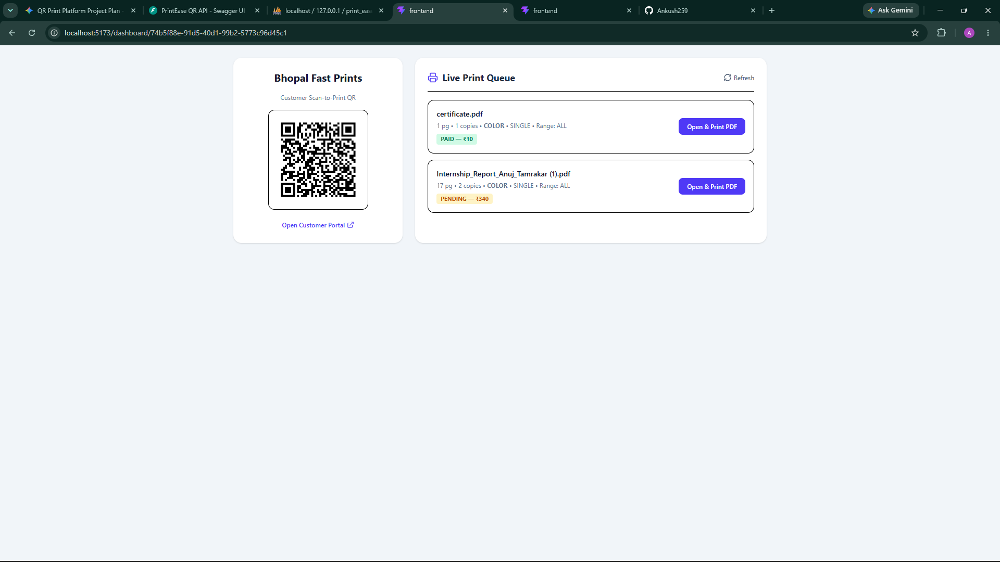
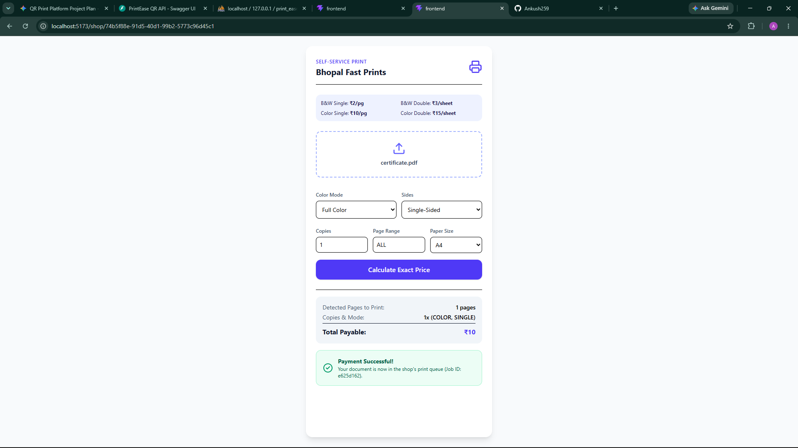
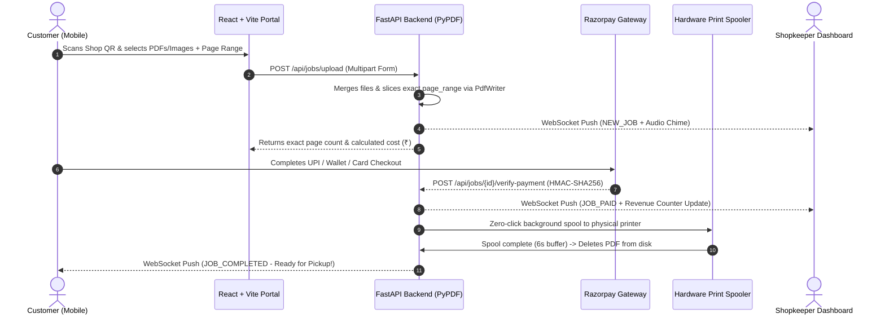

# PrintEase QR 🖨️

A full-stack, zero-click SaaS platform for print shops. Walk-in customers upload documents via QR scan, pay via Razorpay, and trigger automatic physical hardware printing with privacy-focused file deletion.

## 📸 Project Screenshots

*(Replace these placeholder links with actual images once you take your final screenshots)*


*Shopkeeper Dashboard featuring Live Queue, Revenue Analytics, and Rate Card Editor.*


*Customer Scan-to-Print Portal with live pricing and Razorpay integration.*

## 🚀 Key Features

*   **Zero-Click Hardware Auto-Print:** Direct OS spooler integration (Windows/macOS) the millisecond payment is verified.
*   **Privacy-First Auto-Wipe:** Customer PDFs are permanently deleted from the server 6 seconds after spooling.
*   **Smart Document Engine:** Automatically merges multiple PDFs/images and slices custom page ranges on the fly using `pypdf`.
*   **Real-Time Analytics:** FastAPI WebSockets power instant queue updates, audio chimes, and live revenue tracking without page refreshes.

---

## 🏗️ System Architecture & Zero-Click Print Flow



---

## 💻 Local Setup Instructions

### 1. Database Setup (MySQL)
Ensure MySQL (via XAMPP or native) is running. Create a database named `printease_db`.

### 2. Backend Setup (FastAPI & Python)
Open a terminal and navigate to the `backend` folder:
```bash
cd backend
python -m venv venv

# Activate virtual environment
source venv/Scripts/activate  # Windows (Git Bash)
# source venv/bin/activate    # macOS/Linux

pip install -r requirements.txt
```

Create a `.env` file inside the `backend` folder and add your keys:
```env
RAZORPAY_KEY_ID=rzp_test_your_key_here
RAZORPAY_KEY_SECRET=your_secret_here
JWT_SECRET=printease-super-secret-jwt-key-2026
FRONTEND_URL=http://localhost:5173
```

Start the Python server:
```bash
uvicorn app.main:app --reload
```

### 3. Frontend Setup (React + Vite)
Open a new terminal tab and navigate to the `frontend` folder:
```bash
cd frontend
npm install
npm run dev
```

### 4. Hardware Auto-Print Requirements (Windows Only)
To enable true zero-click printing on Windows, you must set a dedicated PDF viewer like **SumatraPDF** or **Adobe Acrobat Reader** as your default `.pdf` application in Windows Settings. *(Microsoft Edge blocks automated background print spooling).*

---

## 🔌 Core REST & WebSocket API Reference

| Method | Endpoint | Description |
| :--- | :--- | :--- |
| `POST` | `/api/shops/` | Registers a new print shop, pricing card, and generates its unique QR code |
| `GET` | `/api/shops/{shop_id}` | Fetches shop metadata, live per-page rate card, and regenerates missing QR images |
| `POST` | `/api/shops/{shop_id}/login` | Authenticates shopkeeper PIN and returns a signed `HMAC-SHA256` bearer token |
| `PUT` | `/api/shops/{shop_id}/pricing` | Protected route to update live per-page rates from the shop dashboard |
| `POST` | `/api/jobs/upload` | Merges multiple PDFs/images, slices custom page ranges (`1-3, 5`), and calculates cost |
| `POST` | `/api/jobs/{job_id}/create-order` | Creates a Razorpay order in paise (with automatic Demo Sandbox fallback) |
| `POST` | `/api/jobs/{job_id}/verify-payment` | Verifies Razorpay signature and triggers hardware auto-print and auto-wipe |
| `PATCH` | `/api/jobs/{job_id}/complete` | Fallback route to manually mark print job `COMPLETED` and wipe customer PDF |
| `WS` | `/api/jobs/ws/{shop_id}` | Real-time bidirectional WebSocket channel for live queue & customer status updates |
