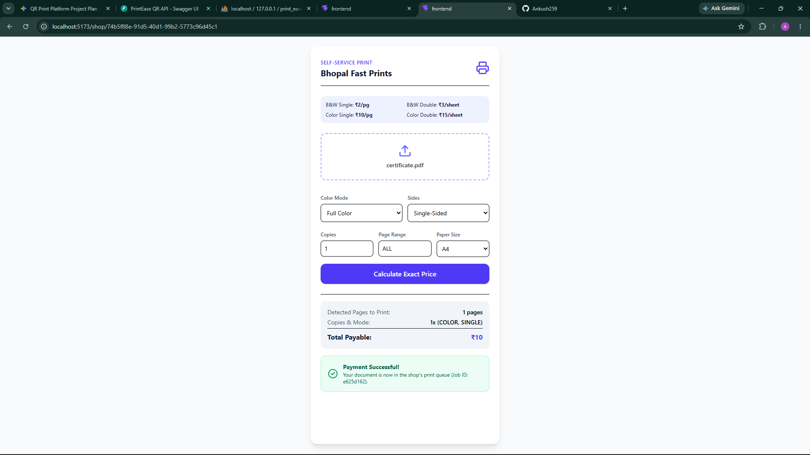
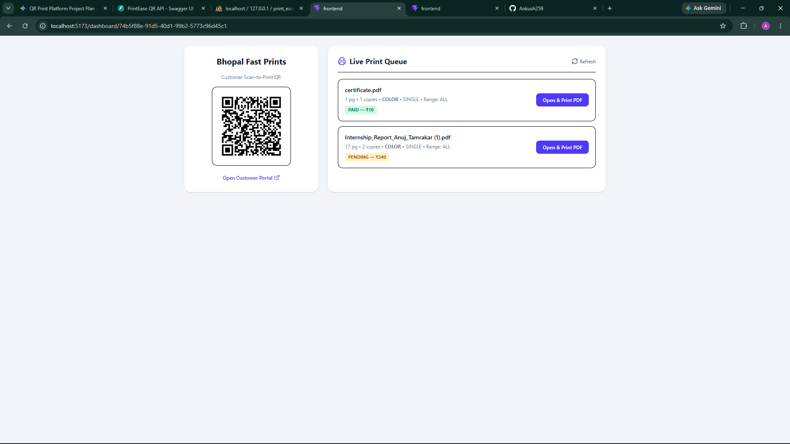

# PrintEase QR — Self-Service Print Shop Automation System

A multi-tenant QR-based print automation web platform that eliminates WhatsApp and email file sharing at local print shops. Customers scan a shop's unique QR code, upload PDFs or images, customize print settings with live page counting, pay via UPI, and trigger zero-click local printing.

---

## Live UI Previews

### 1. Customer Scan-to-Print Mobile Portal (`/shop/:shopId`)


### 2. Shopkeeper QR & Live Print Queue Dashboard (`/dashboard/:shopId`)


---

## Key Features
- **Multi-Tenant Shop Onboarding:** Dynamic QR code generation (`/shop/:shopId`) and custom per-page rate cards (B&W/Color, Simplex/Duplex).
- **Automated Page & Range Parser:** Counts PDF pages server-side using `pypdf`, converts images via `Pillow`, and supports custom page ranges (`1-5, 8`).
- **Live Print Customizer:** Mobile-first React + Tailwind CSS interface with live grayscale/color preview and instant bill calculation.
- **Zero-Click Hardware Print Agent & Auto-Delete:** Local Python background script spools paid jobs directly to the shop's Windows printer and deletes files post-print for customer privacy.

## Tech Stack
- **Frontend:** React (Vite), Tailwind CSS, React Router, Axios, Lucide Icons
- **Backend:** Python, FastAPI, SQLAlchemy ORM, PyPDF, Pillow, QRCode
- **Database:** MySQL (XAMPP)

## Local Setup Instructions

### 1. Backend (FastAPI + MySQL)
```bash
cd backend
python -m venv venv
source venv/Scripts/activate
pip install -r requirements.txt
uvicorn app.main:app --reload